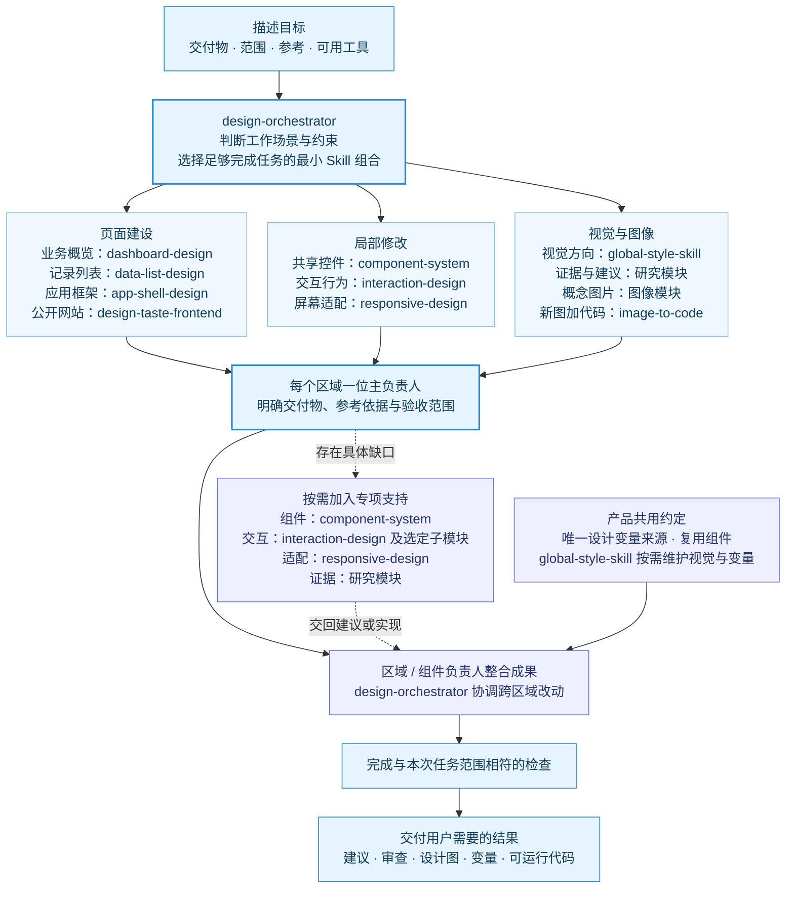

<p align="center">
  
</p>

<p align="center">
  <a href="LICENSE"></a>
  <a href="https://github.com/Getaway-Wuji/PivotUI/pulls"></a>
</p>

# PivotUI

**你描述要做的界面，Skill 集群负责选择和协作。**

简体中文 · [English](README.en.md) · [安装配置](docs/INSTALL.zh-CN.md) · [架构图](#architecture) · [全部 Skill 详解](#skills) · [架构与任务分配](docs/ARCHITECTURE.zh-CN.md)

PivotUI 是一套面向 UI 设计与实现的 **Skill 集群**，把任务分配、全局风格、页面设计、组件、交互、响应式、设计研究和外源工作流组织成可协作的系统。它的核心想法是：**用户只需要说明要完成什么，不必每次翻找 Skill、判断该选哪一个，再逐一交代它们如何配合。**

管理层先理解你要的结果，为每个区域确定主负责人，再根据具体缺口引入辅助 Skill，并把结果整合到同一个产品中。从业务结构到可运行界面，各模块共享已有主题、组件和设计决策，减少重复选择与来回协调。

当前版本 **0.4.0** 包含 **23 个包：9 个内源模块、14 个外源包**；计入交互模块的 4 个子入口，共有 **27 个标准 `SKILL.md` 入口**。中文与英文版均可独立使用；外源包在两版中保留上游原语言和声明。

## 什么是 Skill 集群？

一个 Skill 是针对某类工作的可复用方法与指令，通常配有参考资料、脚本、模板或数据。Skill 集群在多个独立 Skill 之间建立明确的协作机制：

- **统一入口理解任务**：识别用户要建议、设计图、设计变量、局部修改，还是完整代码。
- **独立模块承担职责**：每个模块有自己的适用场景、输入、输出和工作边界。
- **共用约定保持一致**：主题、组件和任务归属能够在模块之间延续。
- **按需读取必要内容**：先看能力目录，再读取选中的入口和相关资料。

在 PivotUI 中，真正理解任务、应用规则并完成工作的，是你所使用的宿主工具中的 AI。`design-orchestrator` 提供管理规则，可选的本地 MCP 服务提供能力目录和文件读取。MCP 本身不运行模型，也不执行 Markdown 指令；不使用 MCP 时，也可以通过直接读取文件使用整套集群。

## 它如何提高效率？

| 原本需要反复处理的事情 | PivotUI 的组织方式 |
| --- | --- |
| 每次从 Skill 列表中找合适的工具 | 统一入口根据交付物、页面用途、局部范围和实际工具条件选择能力。 |
| 猜测还需要搭配哪些 Skill | 仅在组件、交互、响应式、研究或主题存在具体缺口时补充专家模块。 |
| 向多个模块重复交代背景 | 用简短任务约定传递区域、负责人、参考、设计变量、组件和验收范围。 |
| 合并互相冲突的颜色、字体和组件 | 产品中保留一份权威设计变量，每个区域由一位主负责人整合。 |
| 为简单任务读取整套资料 | 先发现元数据，再读取选定入口与相关资源；已有规则直接复用。 |
| 已经决定方向后再次调研 | 保留适用的既有主题与决策，只在任务要求或确有缺口时重新研究。 |

这些是具体的流程改进机制，并非经过量化实验的提效百分比。实际收益取决于任务复杂度、宿主工具能力和项目已有基础。

## 可以用来做什么？

| 你的需求 | 管理层如何分配 |
| --- | --- |
| “沿用我们的主题，做一个运营 Dashboard。” | `dashboard-design` 主导指标、图表和概览内容，复用现有框架与主题，按缺口补充支持。 |
| “做订单列表，带筛选、批量操作，并能从详情回到原位置。” | `data-list-design` 负责完整列表流程和操作范围，按需加入共享控件、异步交互与窄屏适配。 |
| “统一后台各页面的导航、标题和滚动。” | `app-shell-design` 负责应用框架与路由约定，各页面模块继续负责业务内容。 |
| “修复保存失败后丢失输入的表单。” | `form-interaction` 与相关异步规则处理局部问题，继承周围的布局和主题。 |
| “先比较几种设计方向，再决定做哪种。” | `global-style-skill` 提供候选与建议；需要具体产品证据时引入 `design-reference-research`，仅咨询时只交付建议。 |
| “制作一个公开产品官网。” | 可由适配当前要求的 `design-taste-frontend` 主导，先核对其工作流与项目要求、工具条件是否兼容。 |
| “生成移动端界面概念图”或“制作品牌视觉板。” | 选择对应的图像设计 Skill，通过实际可用的图像工具生成结果。 |
| “只修复手机上表格溢出。” | `responsive-design` 处理具体内容与操作约束。 |

混合项目、原图还原、可选风格和任务交接的详细示例见[架构与任务分配](docs/ARCHITECTURE.zh-CN.md)。

<a id="architecture"></a>

## 管理层如何分配任务、各模块如何配合？

管理层由 `design-orchestrator` 为每个区域选择主负责人，`global-style-skill` 按需负责视觉方向与设计变量。**实线表示任务推进，虚线表示为具体缺口加入的辅助协作。** 混合项目可以组合多个分支，局部修复可以直接由对应专项模块负责；每次只读取选中的 Skill 和必要资源。



- **研究与图像如何选择：** 通用建议使用 `ui-ux-pro-max`，指定产品证据使用 `design-reference-research`。概念图片按用途选择 `imagegen-frontend-web`、`imagegen-frontend-mobile` 或 `brandkit`；`image-to-code` 先生成新参考图，再实现代码。忠实还原任务保留用户原图为目标。图像流程需要实际可用的图像生成工具。
- **协作示例：** 订单管理页由 `data-list-design` 主导；保存时丢失草稿，就加入 `form-interaction`；缺少共用控件，就加入 `component-system`；窄屏布局有问题，就加入 `responsive-design`。各模块把贡献交回指定负责人，沿用同一套主题与组件整合。
- **明确选择的能力：** 可选 classics 风格、Stitch 和历史版本需要明确选择，`gpt-taste` 仅用于公开营销。图中的角色由宿主 AI 执行；可选 MCP 提供能力目录和选定文件，不负责调度或执行工作。

## 集群结构

```text
English/ 或 Chinese/
├── orchestration/       任务分配与全局视觉决策
├── page-design/         Dashboard、数据列表、应用框架、公开网站
├── interaction/         共用交互规则与四个专项子模块
├── components/          可复用组件实现
├── responsive/          布局、输入方式与溢出适配
├── design-research/     UI/UX 建议与产品案例研究
├── visual-styles/       需明确选择的外源风格工作流
├── image-design/        网站图、移动端图、品牌板、先图后代码
├── tool-integrations/   面向 Stitch 的设计工作流
├── legacy/              明确指定时使用的历史工作流
├── design-system/       共用方法与职责约定
└── mcp/skill-cluster/    可选的本地能力目录与文件读取服务
```

内源与外源包按功能放在同一分类下，来源在文档中明确标注。目录名与 Skill 的 YAML 名称有时不同，例如 `taste-skill` 是 `design-taste-frontend` 的包目录，二者属于同一个能力。

## 快速开始

支持 **Codex、Claude Code、DSH（DeepSeek Harness）、Cursor 和其他兼容 Agent**。选择下面任意一种安装方式即可：两种方式都会提供一个原生 **pivotui** 入口，按任务读取完整集群中的 **27 个模块入口**。

下面先介绍只装到一个项目里的方法。如果想让多个项目都能用，直接看[全局安装](#global-install)。npx 和压缩包两种方式都支持。

### 方式一：一条 npx 命令安装

准备好 **Node.js 22+ 和 npm/npx**，在目标项目根目录打开终端，执行：

```sh
npx --yes --package=https://github.com/Getaway-Wuji/PivotUI/releases/download/v0.4.0/pivotui-installer-v0.4.0-r2.tgz pivotui --agent codex --language zh
```

npx 会下载打包好的安装包并运行，不需要 Git 或 Python。首次下载可能较慢，请等到出现 **`Installed PivotUI ...`**，才表示安装完成；转圈停止本身不代表成功。其他 Agent 使用对应命令：

```sh
# Claude Code
npx --yes --package=https://github.com/Getaway-Wuji/PivotUI/releases/download/v0.4.0/pivotui-installer-v0.4.0-r2.tgz pivotui --agent claude-code --language zh
# DSH / DeepSeek Harness
npx --yes --package=https://github.com/Getaway-Wuji/PivotUI/releases/download/v0.4.0/pivotui-installer-v0.4.0-r2.tgz pivotui --agent dsh --language zh
# Cursor
npx --yes --package=https://github.com/Getaway-Wuji/PivotUI/releases/download/v0.4.0/pivotui-installer-v0.4.0-r2.tgz pivotui --agent cursor --language zh
```

英文版使用 `--language en`。默认安装到当前项目：完整集群放在 `.pivotui/libraries/`，原生入口放在 `.agents/skills/pivotui/`，Claude Code 则使用 `.claude/skills/pivotui/`。加上 `--global` 可安装到用户范围。[其他 Agent、自定义目录和预览](docs/INSTALL.zh-CN.md#command-install)。

### 方式二：下载 ZIP，复制两个文件夹

下载一套**安装 ZIP**：[中文版](https://github.com/Getaway-Wuji/PivotUI/releases/download/v0.4.0/PivotUI-Chinese-project-v0.4.0-r2.zip) · [English](https://github.com/Getaway-Wuji/PivotUI/releases/download/v0.4.0/PivotUI-English-project-v0.4.0-r2.zip)。同一个 ZIP 既可以只装到一个项目，也可以[全局安装](#global-install)。

如果你用的是 **Codex、DSH 或 Cursor**：

1. 解压 ZIP，打开解压出来的 `PivotUI-Chinese` 或 `PivotUI-English` 文件夹。
2. 同时选中 **`.agents` 和 `.pivotui` 两个文件夹**，复制，再粘贴到你的项目文件夹里。整个文件夹一起复制，不用点进去挑文件。
3. 在 Agent 中打开这个项目，新建一个对话，选择 **pivotui**。

复制完成后，你的项目里应该是这样：

```text
你的项目/
├── .agents/
└── .pivotui/
```

项目文件夹就是你在 Agent 中打开的那个最外层文件夹，把这两个文件夹放在已有项目文件旁边即可。**复制到哪个项目，哪个项目就装好了**，不用再运行安装命令。

**Claude Code 用户：**先在**解压出来的文件夹里**把 `.agents` 改名为 `.claude`，再将 `.claude` 和 `.pivotui` 一起复制到项目。不要给项目里原有的文件夹改名。

项目里已有同名文件夹时，合并内容，保留其他文件。若提示覆盖同名文件，先核对是否要替换自己原有的 PivotUI 文件。看不到这两个文件夹时，打开“显示隐藏文件”。压缩包里附有 `INSTALL.md`，也可查看[一步步复制说明](docs/INSTALL.zh-CN.md#zip-install)。

安装完成后，在这个项目的新对话中选择 **pivotui**，描述你要做的界面即可。

<a id="global-install"></a>

### 全局安装：装一次，多个项目共用

**全局指的是当前电脑上的当前用户。** 安装后，你使用的本地 Agent 可以在不同项目中使用 PivotUI，新建项目时不用再复制一遍。

**用压缩包：把两个文件夹放进“用户文件夹”。** Codex、DSH 或 Cursor 用户这样做：

1. 解压 ZIP，打开解压出来的 `PivotUI-Chinese` 或 `PivotUI-English` 文件夹。
2. **Windows：**打开文件资源管理器，在上方地址栏输入 **`%USERPROFILE%`**，按回车，就进入了你的用户文件夹。**macOS / Linux：**打开用户主文件夹（`~`）。
3. 把解压出来的 **`.agents` 和 `.pivotui` 两个文件夹一起复制进去**，放成这样：

```text
你的用户文件夹/
├── .agents/
└── .pivotui/
```

**Claude Code 用户：**先在解压副本里把 `.agents` 改名为 `.claude`，再将 `.claude` 和 `.pivotui` 一起复制到用户文件夹。不要改已有文件夹的名字。

目标位置已有同名文件夹时，合并内容，保留其他 Skill 和设置；遇到同名文件覆盖提示时，先核对自己是否改过原来的 PivotUI 文件。

**用 npx：加上 `--global`。** 准备好 Node.js 22+ 和 npm/npx 后，在任意文件夹打开终端，执行：

```sh
npx --yes --package=https://github.com/Getaway-Wuji/PivotUI/releases/download/v0.4.0/pivotui-installer-v0.4.0-r2.tgz pivotui --agent codex --language zh --global
```

Claude Code 把 `codex` 换成 `claude-code`，DSH 换成 `dsh`，Cursor 换成 `cursor`。英文版使用 `--language en`。如果你设置过 `CLAUDE_CONFIG_DIR` 或 `DSH_AGENTS_HOME`，使用这条命令路线，让安装器设置对应的路径；详见[全局目录与自定义配置](docs/INSTALL.zh-CN.md#global-zip-install)。

任意一种方式完成后，在你使用的本地 Agent 中打开一个项目，新建对话即可使用 **pivotui**。这份安装供当前用户使用；其他账号、远程机器或云端会话需要放到它们各自的安装位置。

原来的完整语言版压缩包也保留，供原始文件或 MCP 接入使用：[中文版 ZIP](https://github.com/Getaway-Wuji/PivotUI/releases/download/v0.4.0/PivotUI-Chinese-v0.4.0.zip) · [English ZIP](https://github.com/Getaway-Wuji/PivotUI/releases/download/v0.4.0/PivotUI-English-v0.4.0.zip)。详见[安装指南](docs/INSTALL.zh-CN.md)和[验证记录](docs/VALIDATION.md)。

<a id="skills"></a>

## 每一个 Skill 分别用来做什么？

下面逐项介绍全部 **27 个入口**：**9 个内源包、14 个外源包，以及随交互父包提供的 4 个子模块**。内源模块由 PivotUI 编写；外源模块逐项标注上游作者，并保留 MIT 声明。安装时创建的原生 `pivotui` 入口负责引导读取这套库，不另计为第 28 个设计 Skill。入口链接指向中文版，英文版使用相同的标识和目录结构。

### 管理层与全局视觉方向

#### `design-orchestrator` — 理解需求、分配工作、整合结果

**内源 · [Skill 入口](Chinese/orchestration/design-orchestrator/SKILL.md)。** 集群的统一入口，先判断你要的是建议、审查、设计图、设计变量还是可运行代码，再选择足够完成任务的最小能力组合。它为每个区域指定一位负责人，传递参考与已有产品决策，整合各专项模块的成果。例如，带新筛选表单的 Dashboard 可以由 Dashboard 模块主导页面，表单交互模块补充提交行为。产出是任务分工与整合后的交付物；实际工作由宿主 AI 按这些规则完成。

#### `global-style-skill` — 建立和维护产品视觉系统

**内源 · [Skill 入口](Chinese/orchestration/global-style-skill/SKILL.md)。** 负责比较视觉方向，以及管理颜色、字体、间距、形状等设计变量。包含 40 张风格参考卡，只在需要探索方向时加载。例如品牌升级时，它可以比较候选、更新已采用的主题，并检查非法值、缺失引用、重名和实际使用情况。根据任务交付方向建议、变量修改或具体检查结果。最终采用的主题在目标产品中只有一份权威来源，页面组织和组件实现由各自负责人完成。

### 页面设计

#### `dashboard-design` — 将业务问题变成有用的概览与分析页面

**内源 · [Skill 入口](Chinese/page-design/dashboard-design/SKILL.md)。** 用于业务概览、分析、监控、工作台和账户资源汇总。围绕用户需要做出的判断，安排指标、图表、对比周期、信息优先级和下钻操作。例如运营看板既要呈现当前业绩，也要解释变化并提供后续处理入口。产出可以是设计规格或可运行页面，包含加载、空结果、错误和数据过期等状态。复用已有应用框架和主题，完整记录管理列表交给数据列表模块。

#### `data-list-design` — 把查找记录与处理记录串成完整流程

**内源 · [Skill 入口](Chinese/page-design/data-list-design/SKILL.md)。** 负责完整业务列表页，包括搜索、已应用筛选、排序、分页、列与视图设置、选择、批量操作、导出和详情返回。例如订单列表需要明确操作影响哪些记录，区分“选择当前页”与“选择全部匹配结果”，并在编辑返回后恢复筛选条件和页码。它交付连贯的列表设计规格或实现。可复用 Table 与控件由组件系统实现；本模块决定这些控件的业务含义及周围的工作流程。

#### `app-shell-design` — 搭建多个页面共用的应用框架

**内源 · [Skill 入口](Chinese/page-design/app-shell-design/SKILL.md)。** 组织持续存在的导航、面包屑、页面标题与操作区、内容宽度、固定区域和滚动。适用于多个后台页面需要统一框架，或列表、详情、编辑之间切换时容易丢失上下文的情况。产出包括框架设计或实现，明确路由元数据和页面插槽，并检查嵌套路由、长标签、折叠、键盘操作及窄屏、短屏表现。各页面模块继续负责业务内容，已有路由和有效导航模式按需保留。

#### `design-taste-frontend` — 设计和实现公开网站

**外源 · Leonxlnx · [上游项目](https://github.com/Leonxlnx/taste-skill) · [Skill 入口](Chinese/page-design/taste-skill/SKILL.md)。** 现行 taste 工作流，用于适合其方法的公司、产品、服务、场所、作品集和公开营销网站，也包含改版与审查。它将页面结构、文案、照片或产品图、字体、布局、动效和浏览器检查组织起来，例如从公司需求简介推进到可运行官网。选用前会核对上游较强的默认要求是否兼容已有产品及任务范围；它不主导业务 Dashboard。需要 Node.js 22+ 和 Chrome、Edge 或 Chromium，ffmpeg 可选。

### 交互与反馈

#### `interaction-design` — 协调状态变化、操作结果与失败恢复

**内源 · [Skill 入口](Chinese/interaction/interaction-design/SKILL.md)。** 定义什么触发操作、状态如何变化、用户看到什么反馈，以及如何退出或恢复。负责防重复执行、过时响应、结果未知、失败后保留上下文等共用异步行为。例如批量更新时，明确处理中、已确认、部分完成和失败的结果。产出行为规格或实现修改，并只读取下面实际需要的子模块。需要时加入动效，但动画播放结束不能作为请求成功的依据。

#### `button-interaction` — 让命令按钮的行为清晰可靠

**内源交互子模块 · [Skill 入口](Chinese/interaction/interaction-design/sub-skills/button-interaction/SKILL.md)。** 规定按钮的 hover、focus、pressed、disabled、pending、结果与恢复行为。例如保存按钮需要保持点击区域稳定、防止重复执行，并区分短暂反馈和真实操作状态。覆盖原生语义、键盘激活、可访问名称，以及长按、滑动手势的等价可访问操作。交付可实现的按钮行为约定或局部修复。整表校验与导航交给对应模块；错误保留在相关位置或 Alert 中。

#### `form-interaction` — 保留用户输入，让提交过程可靠

**内源交互子模块 · [Skill 入口](Chinese/interaction/interaction-design/sub-skills/form-interaction/SKILL.md)。** 负责字段、选择器、开关、滑块、校验、筛选控件和提交反馈。可修复“保存失败后草稿丢失”“慢请求覆盖了后来修改”等问题。规则区分已提交快照与当前输入，关联字段错误、安排合理焦点、尊重输入法组合输入，并保持已应用筛选与结果一致。产出范围明确的字段和请求行为，保留原页面结构与既定业务校验规则。

#### `navigation-interaction` — 保持当前位置和焦点清晰

**内源交互子模块 · [Skill 入口](Chinese/interaction/interaction-design/sub-skills/navigation-interaction/SKILL.md)。** 为侧栏、面包屑、Tabs 和命令菜单定义当前位置、分组展开、键盘操作和焦点连续性。例如可折叠侧栏需要区分当前路由、hover、focus 与展开状态，导航失败时不能错误地改变当前位置。也处理条目消失或重排后的焦点恢复。产出导航行为约定或实现修复；原生链接保留导航语义，信息架构与布局仍由框架或页面负责人决定。

#### `floating-components` — 选择合适的浮层与反馈组件

**内源交互子模块 · [Skill 入口](Chinese/interaction/interaction-design/sub-skills/floating-components/SKILL.md)。** 选择并规定 Tooltip、Toast、Alert、Modal、Popconfirm 和 Drawer 的行为。例如不可逆删除使用 Modal 确认，持续错误使用 Alert，需要保留周围上下文的编辑可以使用 Drawer；本集群约定 Toast 不承载错误。它定义打开、关闭、焦点、背景访问、异步恢复和窄屏替代方案。Drawer 排除简单表单和全屏任务。产出是有依据的组件选择与完整交互行为。

### 可复用组件

#### `component-system` — 实现共享控件，明确组件接口

**内源 · [Skill 入口](Chinese/components/component-system/SKILL.md)。** 建立或适配共享组件，统一结构、变体、尺寸、状态归属、事件和无障碍行为。例如统一 Dashboard 与订单列表共用的状态控件，或适配现有 Table 接口。优先复用、配置、组合已安装的组件库，仅为已经确认的缺口新建组件。产出可复用实现及经过检查的使用示例。页面负责人决定业务内容如何组织，一次性区块不必自动抽成公共组件。

### 响应式适配

#### `responsive-design` — 在不同屏幕和输入条件下保持任务可用

**内源 · [Skill 入口](Chinese/responsive/responsive-design/SKILL.md)。** 根据可用宽度、高度和输入方式，调整布局、导航、图表、表格、固定区域与控件。例如订单表格在窄屏溢出时，它会确定必须保留的信息、重排方式，以及用户如何继续筛选和处理记录。产出局部布局与行为修改，并检查相关变化边界。保留阅读顺序、键盘操作、选择、草稿和关键业务字段，继承产品视觉系统，避免用全局裁切掩盖溢出或无关地重做整个页面。

### 设计研究

#### `design-reference-research` — 有来源地研究具体产品案例

**内源 · [Skill 入口](Chinese/design-research/design-reference-research/SKILL.md)。** 查找与比较具体产品参考，区分来源观察和设计建议。包含署名的 [VoltAgent/awesome-design-md](https://github.com/VoltAgent/awesome-design-md) 元数据：84 条来源记录，其中 8 张案例卡经过文档审阅，另外 76 条仅有索引。例如用户希望借鉴某款产品时，它会选择相关案例，说明哪些关系可迁移、哪些需要适配、哪些尚未检查。研究结果交给指定负责人；文档审阅不代表验证了当前网站行为，也不自动授权更换产品主题。

#### `ui-ux-pro-max` — 检索设计指南，比较候选方案

**外源 · nextlevelbuilder · [上游项目](https://github.com/nextlevelbuilder/ui-ux-pro-max-skill) · [Skill 入口](Chinese/design-research/ui-ux-pro-max/SKILL.md)。** 从本地数据集检索风格、配色、字体、UX、图标、动效、图表和技术栈建议。例如针对一个业务问题比较图表类型，或寻找适合无障碍要求的配色候选。可以返回专项结果或较完整的设计系统建议，由当前负责人判断是否采用。在 PivotUI 中，它负责研究与建议；页面实现和已经采用的设计变量保留原有归属。搜索需要 Python 3.x，无额外依赖。

### 可选视觉风格

下面四个上游工作流都需要**明确选择**。管理层可以推荐合适方向，仅仅安装它们不会自动启用，也不会自动改变产品主题。

#### `gpt-taste` — 表现力鲜明的公开营销页面

**外源 · Leonxlnx · [上游项目](https://github.com/Leonxlnx/taste-skill-classics) · [Skill 入口](Chinese/visual-styles/gpt-tasteskill/SKILL.md)。** 为明确选定的营销方向提供变化的 Hero 构图、AIDA 页面推进、素材主导分区和 GSAP 滚动动效。例如制作开场鲜明、转化路径清晰的产品发布页面。按约定交付设计或实现，并核对真实可用的代码与动效依赖。**仅用于公开营销，绝不分配给 Dashboard 或业务工具。** 使用范围与已有产品决策继续有效。

#### `high-end-visual-design` — 柔和精致的视觉方向

**外源 · Leonxlnx · [上游项目](https://github.com/Leonxlnx/taste-skill-classics) · [Skill 入口](Chinese/visual-styles/soft-skill/SKILL.md)。** 提供柔和对比、大留白、特色字体、触感层次与弹性动效，包含玻璃、编辑式奢华、柔和结构等方向及移动端变化。适合明确希望采用这类表达的品牌体验，或需要相应视觉语言的局部区域。产出方向建议或实现，并与实际字体、依赖、无障碍要求及已采用变量协调。这些是可选的上游方法，不是所有 PivotUI 项目的默认风格。

#### `minimalist-ui` — 克制的编辑式与产品布局

**外源 · Leonxlnx · [上游项目](https://github.com/Leonxlnx/taste-skill-classics) · [Skill 入口](Chinese/visual-styles/minimalist-skill/SKILL.md)。** 采用暖色单色表面、排版主导的信息层级、平面结构化网格和少量柔和强调色。需求明确适合这种克制表达时选用，例如以清晰字体层级和简洁控件呈现产品内容。交付限定范围内的视觉方向或实现。具体的字体、图标、形状和配色规则先与目标产品核对，采用后整合到已约定的设计来源中。

#### `industrial-brutalist-ui` — 结构鲜明的工业视觉语言

**外源 · Leonxlnx · [上游项目](https://github.com/Leonxlnx/taste-skill-classics) · [Skill 入口](Chinese/visual-styles/brutalist-skill/SKILL.md)。** 使用严格模块网格、瑞士风格排版、强烈尺度对比、功能性颜色和可选的模拟显示器处理。浅色工业印刷与深色遥测/终端是需要刻意选择的不同方向。产品或区域明确需要这类表达时调用，交付约定的风格处理或实现。页面负责人继续掌握业务结构与可读性，视觉方向不能成为虚构数据、遗漏关键操作或更改无关全局主题的理由。

### 图像设计

下面四个图像工作流均需要实际可用的图像生成工具。集群提供方法与指令，不自行提供图像生成服务。

#### `imagegen-frontend-web` — 生成网站分区设计参考图

**外源 · Leonxlnx · [上游项目](https://github.com/Leonxlnx/imagegen-skills) · [Skill 入口](Chinese/image-design/imagegen-frontend-web/SKILL.md)。** 为落地页、营销页和产品页分区创作视觉概念。默认每个分区生成一张独立横向图片，在保持配色一致的同时变化构图。例如分别提供 Hero、功能介绍和价格区的设计图供审阅，并遵循用户要求的数量与格式。产出是设计参考图片；转换为可运行前端是后续实现任务，还需要落实交互与响应式行为。

#### `imagegen-frontend-mobile` — 生成移动端屏幕与流程概念图

**外源 · Leonxlnx · [上游项目](https://github.com/Leonxlnx/imagegen-skills) · [Skill 入口](Chinese/image-design/imagegen-frontend-mobile/SKILL.md)。** 创作引导、登录、首页、电商、个人页、设置等移动应用屏幕及相关流程。多屏之间保持清晰层级、平台特征、一致展示方式和共同视觉语言，例如生成从引导到首页的一组连贯概念图。上游默认使用轻量手机外框，可根据用户要求调整。交付屏幕图片，不等同于应用代码、桌面布局或已经实现的响应式行为。

#### `brandkit` — 展示连贯的品牌视觉形象

**外源 · Leonxlnx · [上游项目](https://github.com/Leonxlnx/imagegen-skills) · [Skill 入口](Chinese/image-design/brandkit/SKILL.md)。** 生成品牌规范板、Logo 系统概念、视觉世界展示和品牌应用，用符号、简洁排版、协调图像与样机呈现统一想法。例如为新产品展示候选标志、配色和应用效果。产出支持品牌探索与审阅，不自动等同于获批 Logo、矢量母版、可用字体文件或产品权威设计变量。需要落地时，可由全局风格模块实现已经采用的设计值。

#### `image-to-code` — 从新视觉概念推进到网站实现

**外源 · Leonxlnx · [上游项目](https://github.com/Leonxlnx/imagegen-skills) · [Skill 入口](Chinese/image-design/image-to-code/SKILL.md)。** 先生成新的设计图，分析构图和视觉关系，再实现前端，用清晰的分区参考衔接概念创作与代码交付。用户同时需要这两个阶段，且图像生成与编码能力都可用时选择。忠实还原用户已经提供的图片，应继续以原图为目标，不必先生成新概念。最终实现仍需检查真实交互与响应式表现，静态图片无法证明这些行为已经可用。

### 工具集成

#### `stitch-design-taste` — 为 Google Stitch 编写设计约定

**外源 · Leonxlnx · [上游项目](https://github.com/Leonxlnx/taste-skill-classics) · [Skill 入口](Chinese/tool-integrations/stitch-skill/SKILL.md)。** 需要**明确选择**，产出面向 Stitch 的 `DESIGN.md`，说明氛围、颜色、字体、组件行为、布局、响应式与动效。例如把已经确定的产品方向整理成一致的屏幕生成指令。入口声明需要实际 Stitch 访问，Stitch MCP 连接可选。文档关联产品已采用的设计来源；编写文档、生成屏幕和实现前端代码属于不同交付阶段，需要各自对应的工具和任务范围。

### 历史工作流

下面三个包保留特定旧版本行为，需要**明确指定历史版本**，不会自动作为当前 Skill 的备用方案。

#### `design-taste-frontend-v1` — 保留原版 taste 工作流

**外源 · Leonxlnx · [上游项目](https://github.com/Leonxlnx/taste-skill-classics) · [Skill 入口](Chinese/legacy/taste-skill-v1/SKILL.md)。** 保留原版通过设计变化程度、动效强度和信息密度等参数驱动的工作流，以及 React/Next.js、Tailwind、组件与依赖约定。维护或复现明确依赖此版本的项目时按名称选用，检查真实技术栈后，按该历史规则交付所需设计或实现。保留的默认值不会替代现行 taste 包，也不会覆盖集群中专门的业务页面方法。

#### `design-taste-frontend-v2-experimental` — 保留实验版 taste 工作流

**外源 · Leonxlnx · [上游项目](https://github.com/Leonxlnx/taste-skill-classics) · [Skill 入口](Chinese/legacy/taste-skill-v2-experimental/SKILL.md)。** 保留先读取页面类型、受众、参考、素材与约束，再应用设计参数的实验流程。用于明确选定的历史落地页、作品集和改版工作；其自身范围排除 Dashboard、数据表格和多步骤产品界面。产出遵循固定版本，并根据项目检查依赖。需要这些特定历史行为时选用，不把它当作当前 taste 的别名。

#### `redesign-existing-projects` — 保留早期局部改版方法

**外源 · Leonxlnx · [上游版本](https://github.com/Leonxlnx/taste-skill/tree/e04409a461022e1b9d0e898eac6b9224e2b9dc4e/skills/redesign-skill) · [Skill 入口](Chinese/legacy/redesign-skill/SKILL.md)。** 保留针对现有网站或应用的“扫描 → 诊断 → 修复”流程。检查排版、颜色、表面和布局，再在当前技术栈内提出或执行针对性改进。仅在明确需要早期方法时选用；现行 taste 已包含改版能力，不会因为需求中出现“改版”就自动选择此包。业务页面的负责人和产品共用设计来源继续保留。

版本、完整选择条件、依赖、相似能力对比与来源记录，见[完整 Skill 指南](docs/SKILLS.zh-CN.md)、[架构与任务分配](docs/ARCHITECTURE.zh-CN.md)及[第三方声明](THIRD_PARTY_NOTICES.md)。

## 自动选择的范围与工具条件

管理层在集群声明的边界内完成常规自动选择。上游七个 classics 保留“明确调用”规则，历史版本也需要刻意选择；主控可以推荐这些能力，但不会因为已经安装就静默启用。`gpt-taste` 仅用于公开营销页面，不分配给 Dashboard 或业务工具。

使用集群需要一个能读取指令并执行相应任务的宿主。图像流程需要图像生成工具，Stitch 流程需要对应服务，公开网站的检查流程可能需要 Node 和浏览器。本地 MCP 提供文件，不替代这些执行能力。两套语言版本使用相同标识，每次连接其中一套即可。

## 作者、外源内容与许可证

PivotUI 的集群组织、管理约定及九个内源模块由本项目维护。项目原创内容采用 [MIT 协议](LICENSE)，版权归 © 2026 Getaway-Wuji。**14 个外源包来自各自的上游作者，不是 PivotUI 作者原创。** 发布内容保留它们的原始身份、固定版本、版权声明与许可证文件。

| 上游项目 | 本集群使用的内容 |
| --- | --- |
| [Leonxlnx/taste-skill](https://github.com/Leonxlnx/taste-skill) | 当前公开网站 Skill，以及固定历史版本的改版 Skill |
| [Leonxlnx/taste-skill-classics](https://github.com/Leonxlnx/taste-skill-classics) | 四种视觉方向、Stitch 集成、两个历史 taste 版本 |
| [Leonxlnx/imagegen-skills](https://github.com/Leonxlnx/imagegen-skills) | 四个图像设计与先图后代码包 |
| [nextlevelbuilder/ui-ux-pro-max-skill](https://github.com/nextlevelbuilder/ui-ux-pro-max-skill) | 可检索的 UI/UX 指南、脚本与数据集 |
| [VoltAgent/awesome-design-md](https://github.com/VoltAgent/awesome-design-md) | 内源产品案例研究模块使用的来源元数据 |

具体适用范围与本地适配记录见 [THIRD_PARTY_NOTICES](THIRD_PARTY_NOTICES.md)，以及各包内的 `LICENSE` 和 `UPSTREAM.md`。上游 MIT 协议只覆盖其声明的材料；照片、图标、字体等素材可能另有条款。README 中的署名不能替代随包保留的法律声明。

## 发布内容

本仓库发布可用集群及使用文档，排除本地演示、生成的测试结果、私人启动配置、虚拟环境、缓存、原始调研和中间参考图片。外源工作流实际需要的运行素材及其来源说明随所属包保留。

元数据、资源链接、双语对应和压缩包一致性可单独检查；文件已收录并不代表每个图像服务、浏览器流程或宿主都已执行验证。研究库包含 84 条来源记录与 8 张经过文档审阅的案例卡，各卡明确证据范围；全局风格提供 40 张参考卡，仅在需要探索方向时加载。
