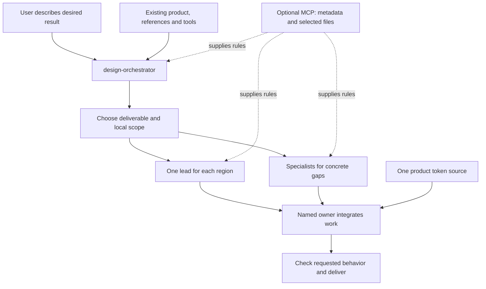

# How PivotUI routes work

[Home](../README.en.md) · [Installation](INSTALL.en.md) · [Skill guide](SKILLS.en.md) · [简体中文](ARCHITECTURE.zh-CN.md)

## The management layer

PivotUI uses three cooperating layers. The **management layer** is `design-orchestrator`, supported by the visual-direction and token responsibilities of `global-style-skill`. The **capability layer** contains independent page, component, interaction, responsive, research, image, and tool-specific modules. The optional **access layer** is a local MCP server that exposes the catalog and selected instruction resources.

The host AI follows this system. A skill is an instruction package, not a separate running worker. A multi-agent host can assign separate workers, while one capable agent can perform the same role-based workflow sequentially. Installing PivotUI does not itself create a model service, background scheduler, or automatic code-execution service.

## The routing decision

1. **Identify the deliverable.** Advice, audit findings, design images, tokens, and working code require different workflows. A request for three style candidates should finish with candidates; a request for implementation should continue to working output.
2. **Establish scope and authority.** Read the relevant existing project, user references, allowed changes, theme, components, target screens, and available tools. An explicitly supplied design can be the authority for faithful reproduction. A local bug remains a local assignment even inside a complex dashboard.
3. **Select a lead.** Assign the business or page responsibility to the most suitable module. For a mixed public website and administration product, assign separate regional leads.
4. **Add support for actual gaps.** Existing adequate behavior does not require a second interaction workflow. A complete theme does not need regeneration. Research is conditional on an unresolved question or explicit comparison.
5. **Carry a compact work agreement.** Record deliverable, region, lead, supporting contributions, token/component source, concrete gaps, and acceptance scope. The same agent can act in several roles without repeating the entire process.
6. **Integrate and verify.** The region/component owner applies compatible proposals, checks the requested flows and outputs, and reports what was actually verified. New evidence or changed requirements can change the route.

## Ownership prevents competing implementations

| Responsibility | Owner | Handoff |
| --- | --- | --- |
| Scope, routing, cross-region decisions | `design-orchestrator` | A concise assignment and consolidated results |
| Direction and token generation/validation | `global-style-skill` | Selected or provisional direction, editable token source, affected scope |
| Dashboard, complete data list, application frame | Corresponding page module | Page structure and business contract within its region |
| Shared component anatomy, interface and variants | `component-system` | Reusable implementation integrated by one component owner |
| State transitions, input, focus and recovery | `interaction-design` and selected leaves | Concrete behavior contract, code or targeted proposals |
| Reflow, input capability and overflow | `responsive-design` | Adaptation conditions while preserving content and operation |
| Evidence and candidates | Research modules | Sources, fit, limitations and recommendations to the existing owner |
| Image concepts | Selected image module | Requested visual assets; implementation remains a separate requested result |

A settings form or detail page has no dedicated standalone page module in this release. The current implementer owns its composition and business flow, supported by relevant component, form, overlay, and responsive guidance. The router does not force every business page into the Dashboard method.

## One product, one authoritative token source

Tokens are named design values such as background, text color, spacing, type size, and radius. They live in the target product's existing CSS variables, theme object, or component configuration. PivotUI supplies methods; it does not impose a universal brand.

For a new product, a suitable page lead may already establish a direction. Global style can complete or validate the values without starting a competing theme. Existing products inherit their current source unless the user requests a change. Different regional needs use named variants, such as marketing typography and dense table controls. The orchestrator coordinates the effects of shared changes.

## Scenarios

### A complete business dashboard

The user wants revenue, incidents, and task progress inside an existing application. Dashboard becomes the content lead and determines the user's primary question, metric definitions, comparison periods, charts, states, and drill-downs. It reuses the existing shell and theme. Component support is added for a missing chart wrapper or shared control; interaction support for a concrete async or focus gap; responsive support for unresolved narrow-screen behavior. It does not require every specialist to run once.

### A list, detail, and edit flow

`data-list-design` owns applied filters, sort, pagination, selection scope, batch operations, export scope, and returning to the list. `app-shell-design` is involved if route context, title placement, or scroll ownership needs work. `form-interaction` protects edit drafts and handles save results; `floating-components` chooses a suitable presentation when needed. The list owner integrates its business behavior, while the shell owner integrates the frame. A page checkbox never silently means every record matching the query.

### A narrow-screen repair

“Fix the horizontal overflow of this table” selects `responsive-design` for the affected area. It identifies which fields and actions must remain available, evaluates scrolling or a task-appropriate arrangement, and checks input and focus. It retains the current theme and selection contract. A narrow viewport does not automatically authorize replacing a Drawer with a full-screen Drawer or rebuilding navigation.

### A public site plus an administration area

A compatible current taste workflow can own the public pages; Dashboard, data-list, and shell modules own business regions. Both consume the adopted product theme through appropriate variants. Marketing motion remains confined to its agreed region. Explicit selection of `gpt-taste` applies only to public marketing, never to the administration area.

### Style exploration or a named-product comparison

Global style starts from the unresolved choice and reads only useful cards among its 40 references. `ui-ux-pro-max` can supply additional style, typography, palette, or UX candidates. `design-reference-research` can compare concrete product examples, normally beginning with 1–3 relevant cards. The 84-source inventory includes eight document-reviewed cases and 76 indexed-only records; indexed availability is not proof of reviewed product behavior. Research returns evidence and adaptations to the decision owner. Advice-only work does not write a new theme or implement pages.

### Images and code are distinct outputs

For website section concepts, use `imagegen-frontend-web`; for app screens, use `imagegen-frontend-mobile`; for an identity board, use `brandkit`. These require an actual image tool. `image-to-code` is the separate workflow that first generates new design images, then analyzes and implements them. If the user supplies a design to reproduce faithfully, keep that original image authoritative and use an image-capable implementer; generating a replacement reference would change the assignment.

### An explicitly selected external style or historical version

The four classics styles, Stitch entry, and two classics historical versions retain upstream opt-in metadata. Generic words such as “polished” do not activate them. The router may recommend a suitable option, but explicit selection is required. The historical redesign package also requires a deliberate historical task in this cluster. Unavailable tools do not cause a silent switch to another version.

## How progressive loading works

With MCP, the host first calls `catalog_skills`, which returns names, descriptions, categories, aliases, exact identifiers, and invocation flags without Skill bodies. It calls `load_skill` for selected entries, then `read_skill_file` for needed text resources. Long reads are paginated. The host follows the returned offset and restarts a read if the revision changes.

The three tools are stateless reads. Reuse of already loaded rules is the host's responsibility; the server does not maintain agent memory or semantic case search. A resource index helps discovery but does not replace inline dependency references. Binary assets cannot be fetched through this text reader; workflows that need them require suitable local file or image access.

Without MCP, the host reads the same selected files directly. Keep complete package directories so nested interaction entries can reach their shared resources. Both modes preserve the same regional ownership, explicit-invocation rules, and single-edition choice.

## What completion means

An implementation task should deliver the requested change and appropriate checks, not stop at the routing plan. The final handoff identifies used capabilities, output locations, adopted shared decisions, and actual verification. Document review, file integrity, code inspection, browser execution, and physical-device tests are different kinds of evidence and should be reported separately.

These mechanisms reduce repeated selection and coordination. PivotUI makes no universal quality guarantee or fixed speedup claim; results still depend on the user's requirements, available evidence, model execution, and host tools.
