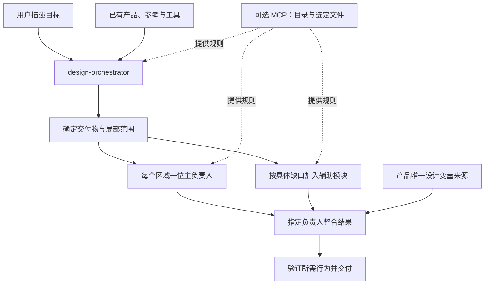

# PivotUI 如何分配任务

[首页](../README.md) · [安装配置](INSTALL.zh-CN.md) · [Skill 详解](SKILLS.zh-CN.md) · [English](ARCHITECTURE.en.md)

## 管理层的组成

PivotUI 由三层配合完成工作。**管理层**以 `design-orchestrator` 为入口，配合 `global-style-skill` 承担视觉方向和设计变量的职责；**能力层**包含独立的页面、组件、交互、响应式、研究、图像和工具模块；可选的**访问层**是本地 MCP 服务，用来提供能力目录与选定文件。

执行这套机制的是宿主中的 AI。Skill 是一组指令和资源，不是独立运行的工作进程。支持多代理的宿主可以分派不同执行者，一个具备相应能力的代理也能按角色依次完成协作。安装 PivotUI 本身不会创建模型服务、后台调度器或自动代码执行服务。

## 任务分配过程

1. **识别交付物。** 建议、审查结果、设计图、设计变量和可运行代码对应不同流程。要求比较三种风格就交付候选；要求实现则继续完成可用结果。
2. **确定范围和依据。** 读取相关项目上下文、用户参考、允许修改的范围、主题、组件、目标屏幕和可用工具。精确还原时，用户指定的设计具有相应范围内的权威性。复杂 Dashboard 内的一处小问题仍然是局部任务。
3. **选择主负责人。** 根据业务与页面职责选合适模块。公开网站和后台混合的项目可以按区域分别指定主负责人。
4. **按实际缺口补充支持。** 已有完整交互不必再走一遍交互流程，主题完整也不需要重建；研究只在存在未解决问题或明确比较需求时加入。
5. **传递简短工作约定。** 记录交付物、区域、主负责人、辅助贡献、设计变量与组件来源、具体缺口和验收范围。同一代理可以承担多个角色，无需重复整个流程。
6. **整合与验证。** 区域或组件负责人采纳兼容的建议，检查请求涉及的流程和输出，报告实际完成的验证。要求变化或新证据可以触发重新分配。

## 用职责划分避免重复实现

| 职责 | 负责人 | 交接内容 |
| --- | --- | --- |
| 范围、任务选择、跨区域协调 | `design-orchestrator` | 简短任务约定与整合结果 |
| 视觉方向、设计变量生成与验证 | `global-style-skill` | 已选或临时候选方向、可编辑的变量来源、影响范围 |
| Dashboard、完整列表、实体详情、表单与设置、应用框架 | 对应页面模块 | 所属区域的页面结构与业务约定 |
| 共享组件结构、接口与变体 | `component-system` | 由一位组件负责人集成的可复用实现 |
| 状态变化、输入、焦点与恢复 | `interaction-design` 及选定子模块 | 具体行为约定、代码或局部建议 |
| 重排、输入条件与溢出 | `responsive-design` | 保留内容和操作的适配条件 |
| 证据和候选 | 研究模块 | 来源、适配理由、边界和建议，返回现有负责人 |
| 图像概念 | 对应图像模块 | 请求的视觉图像；代码实现是另一项明确交付物 |

完整中后台页面矩阵现已由 `app-shell-design`、`dashboard-design`、`data-list-design`、`detail-page-design` 和 `form-workflow-design` 协同覆盖；遇到特殊业务页时，由当前实现者负责页面组织与业务流程，主控不会把所有后台页面都套进 Dashboard 方法。

## 一个产品保留一份权威设计变量

设计变量，即 Token，是背景、文字颜色、间距、字号、圆角等有语义名称的设计值。它们保留在目标产品已有的 CSS 变量、主题对象或组件配置中。PivotUI 提供方法，不给所有产品指定同一套品牌。

新产品的页面主负责人可能已经提出合适方向，全局风格可以补充或验证相应设计值，无需再独立生成另一套主题。已有产品沿用当前来源，除非用户明确要求修改。营销标题与高密度表格等差异通过命名变体表达，共用改动的影响由主控协调。

## 不同场景的分工

### 完整业务 Dashboard

用户希望在现有应用内展示收入、异常和任务进度。Dashboard 模块成为内容负责人，确定首要问题、指标定义、对比周期、图表、状态和下钻路径，复用现有应用框架与主题。缺少共享图表容器或控件时加入组件支持；存在异步或焦点缺口时加入交互支持；窄屏行为尚未解决时加入响应式支持。并不要求所有专家都执行一遍。

### 列表、详情与编辑流程

`data-list-design` 负责已应用筛选、排序、分页、选择范围、批量任务、导出范围和返回列表。路由上下文、标题位置或滚动归属需要调整时，由 `app-shell-design` 参与。`form-interaction` 负责保护编辑草稿并处理保存结果；需要浮层时，由 `floating-components` 选择适当形式。列表负责人整合业务行为，框架负责人整合外围布局。勾选当前页不会静默变成选中所有查询匹配记录。

### 窄屏局部修复

“修复这张表格的横向溢出”由 `responsive-design` 负责受影响区域，确认必须保留的字段和操作，评估横向滚动或适合任务的重排方式，并检查输入和焦点。它沿用当前主题与选择约定；屏幕变窄不会自动授权将 Drawer 变成全屏 Drawer，也不会自动触发整套导航重建。

### 官网与后台同时建设

公开页面可由适配当前要求的 taste 工作流负责；业务区域分别由 Dashboard、列表和应用框架模块负责。它们通过合适变体共享已采用的产品主题。营销动效限制在约定区域内；即使明确选择 `gpt-taste`，它也只能用于公开营销部分，不能接管后台。

### 风格探索或指定产品比较

全局风格从尚未解决的选择出发，在 40 张参考卡中只读相关内容。`ui-ux-pro-max` 可补充风格、字体、配色或 UX 候选；`design-reference-research` 可比较具体产品案例，通常先选 1–3 张相关卡。84 条来源记录中，12 条拥有经过文档审阅的案例卡，另外 72 条仅完成索引；收录来源不等于验证了产品行为。研究将证据和适配建议交回决策负责人。仅咨询时，不写入新主题，也不实现页面。

### 图像与代码分别对应不同结果

网站分区概念图使用 `imagegen-frontend-web`，应用屏幕图使用 `imagegen-frontend-mobile`，品牌视觉板使用 `brandkit`，均需要实际可用的图像工具。`image-to-code` 则是先生成新设计图、再分析并实现的独立流程。如果用户给出一张必须忠实还原的图，应保留原图作为依据，交给能读图的实现者；生成另一张图替代原参考会改变任务。

### 明确指定外源风格或历史版本

四种 classics 风格、Stitch 入口和两个 classics 历史版本保留上游的明确调用设置。“精致”等泛化审美用语不会自动触发它们。主控可以推荐适合的选项，但启用需要明确选择。历史 redesign 包在集群中也需要刻意的历史版本任务。工具不可用时，不会静默换成另一个版本。

## 按需加载如何实现？

使用 MCP 时，宿主先调用 `catalog_skills`，获得名称、说明、分类、别名、精确标识和调用策略，不读取 Skill 正文。选定后调用 `load_skill` 读取入口，再通过 `read_skill_file` 获取需要的文本资源。长文件分段返回，宿主继续读取返回的偏移量；若版本发生变化，则从头读取，避免拼接不同版本。

三个工具都是无状态读取。复用已读规则由宿主负责，服务本身不维护代理记忆，也不提供案例正文的语义搜索。资源索引帮助发现文件，但正文中直接写出的依赖同样需要遵循。二进制素材不能通过这个文本读取器获取，需要使用相应的本地文件或图像能力。

不使用 MCP 时，宿主直接读取同一批选定文件即可。应保留完整包目录，使交互子入口能够访问父包共用资源。两种方式遵循相同的区域职责、明确调用规则和单语言选择约定。

## 怎样才算完成？

实现任务需要交付请求的修改及适当检查，不能止步于路由方案。交接内容包括实际使用的能力、结果位置、采纳的共用决策和真实验证情况。文档审阅、文件完整性、代码检查、浏览器执行和真机测试属于不同证据，应分别说明。

上述机制减少的是重复选择和协调。PivotUI 不承诺普遍适用的质量保证或固定提速倍数；最终结果仍取决于需求、证据、模型执行和宿主工具。
